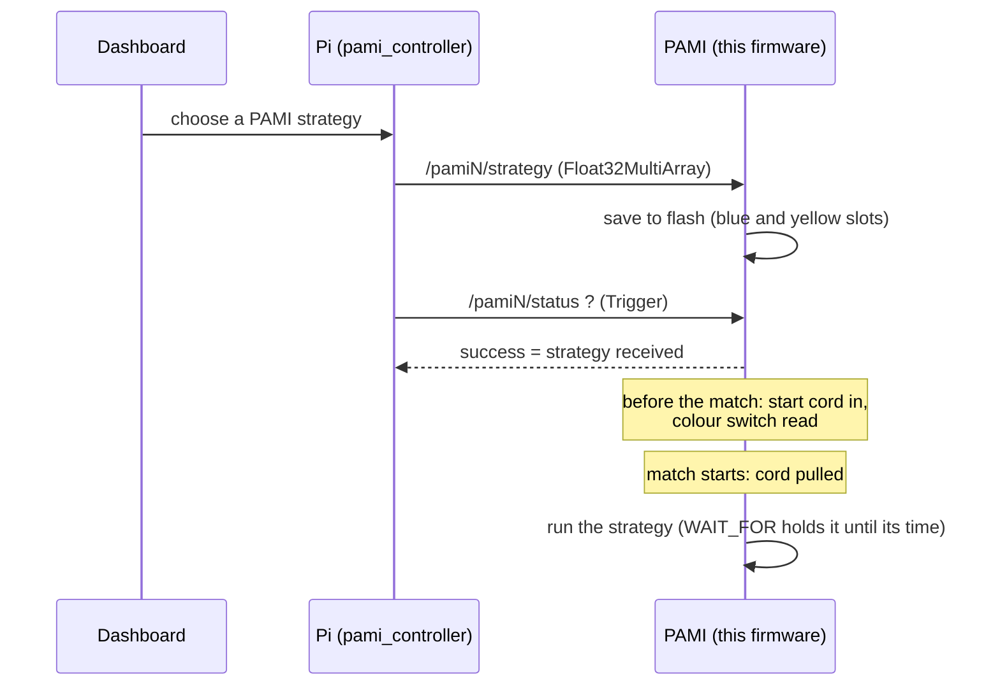

# PAMI_ESP32_code — PAMI robot firmware

Firmware for the **PAMIs** (*Petits Actionneurs Mobiles Indépendants*) of AEROBOTIX INSAT's EUROBOT 2026 team: small autonomous ESP32 robots that are released near the end of the match. Each PAMI receives its strategy from the main robot's Raspberry Pi over **Wi-Fi micro-ROS**, saves it to flash, and runs it on its own when the match timer allows.

The same code base also runs **NINJA**, the PAMI variant with a suction gripper (see the [NINJA_MECANIQUE](https://github.com/Eurobot-2026-Aerobotix/NINJA_MECANIQUE) CAD and the `NINJA*` branches).

## How a PAMI is used in a match



**Two boot modes**, chosen by the start cord (*tirette*) at power-up:

- **Cord inserted → match mode.** No Wi-Fi. The PAMI reads the colour switch, loads the matching strategy from flash, blinks while waiting, and starts when the cord is pulled.
- **Cord absent → setup mode.** The PAMI joins Wi-Fi, connects to the micro-ROS agent, and waits for a new strategy or a `start` command.

## ROS interface

`N` is the PAMI number, set in `src/communication.cpp` (`micro_ros_name = "pamiN"`).

| Name | Type | Direction | Content |
|---|---|---|---|
| `/pamiN/strategy` | `std_msgs/Float32MultiArray` | subscribe | Flat list of commands (below) |
| `/pamiN/start` | `std_msgs/Int32` | subscribe | `1` = start the strategy now |
| `/pamiN/action_done` | `std_msgs/Int32` | publish | Progress feedback |
| `/pamiN/status` | `std_srvs/Trigger` | service | `success = true` once a strategy has been received |

On the Pi, these are used by `pami_controller` and `pami_test_manager` in [ROS2-WS-EURO](https://github.com/Eurobot-2026-Aerobotix/ROS2-WS-EURO), and strategies are edited in the [dashboard](https://github.com/Eurobot-2026-Aerobotix/Eurobot_Dashboard).

## Strategy format

A strategy is a flat list of numbers: a command ID followed by its arguments, then the next command. Distances are in mm, angles in degrees, times in ms. Up to 400 values are stored.

There are **two command sets**. The PAMI branches (`PAMI1` … `PAMI6`) understand IDs 0–6. NINJA (`main` and the `NINJA*` branches) adds the gripper commands 7–13 and an extra `direction` argument to `GOTO`.

| ID | Command | Arguments — PAMI branches | Arguments — NINJA / `main` |
|---|---|---|---|
| 0 | `DELAY` | duration | duration |
| 1 | `GOTO` | x, y, speed | x, y, speed, direction (`1` forward, `-1` backward) |
| 2 | `ORIENTATE` | heading | heading |
| 3 | `SET_POSITION` | x, y, heading | x, y, heading |
| 4 | `BEZIER` | x1, y1, x2, y2, x3, y3, speed, direction | same |
| 5 | `WAIT_FOR` | match time to wait for (ms since start) | same |
| 6 | `BACKWARDS` | distance, speed | distance, speed, x, y, direction |
| 7 | `PICKUP` | — | right pump, left pump, up (`1`) or down (`0`) |
| 8 | `PUTDOWN` | — | gentle drop (`1`/`0`), stack (`1`/`0`) |
| 9 | `WALKING_POSITION` | — | — |
| 10 | `PREPARE` | — | — |
| 11 | `LETGO` | — | — |
| 12 | `MOVE_FORWARD` | — | distance, speed, direction |
| 13 | `ROTATE` | — | angle |

Example for a PAMI branch (dashboard YAML, one command per line):

```yaml
sequence:
- [3, 401.19, 2933.42, -180]   # SET_POSITION
- [5, 85000]                   # WAIT_FOR 85 s into the match
- [1, 410.97, 2908.55, 380]    # GOTO at 380 mm/s
```

The colour is taken from the first `SET_POSITION`: if its **y** is below 1500 mm the strategy is stored as yellow, otherwise as blue. Each colour has its own slot in flash.

## How it works

| Module | Content |
|---|---|
| `src/main.cpp` | Boot modes, strategy interpreter, wheel speed loop |
| `src/navigation.cpp` | Go to, Bézier, orientate, rotate, speed profiles; pauses while the ultrasonic sensor sees an obstacle |
| `src/odometry.cpp` | Encoder odometry |
| `src/HAL.cpp` | Pins, motors, servo, pumps, electrovalve, ultrasonic sensor, start cord, colour switch, flash storage (`Preferences`) |
| `src/communication.cpp` | Wi-Fi, micro-ROS entities, automatic reconnection |
| `src/websocket.cpp` + `server/py_server.py` | Tuning tool: the PAMI streams wheel data to a PyQt plot on a laptop (port 8765), and gains can be changed live |

FreeRTOS tasks run the command interpreter, the wheel PID loop, emergency braking, the WebSocket client, and (in setup mode) micro-ROS communication.

## Branches

Each physical PAMI has its own branch with its calibration and number:

| Branch | Robot |
|---|---|
| `PAMI1` … `PAMI6`, `PAMI_NEW*` | PAMIs 1-6 |
| `NINJA*` | NINJA (suction gripper) |
| `*_hom`, `*_dev` | Homologation and development versions |
| `main` | Shared base |

Flash a PAMI from its own branch.

## Build and flash

Requirements: [PlatformIO](https://platformio.org/).

1. Check out the branch for your PAMI.
2. In `src/main.cpp`, set the Wi-Fi network and the agent's IP and port in the `setup_micro_ros(...)` call. **Do not commit real credentials.**
3. Build and flash:

```bash
pio run -t upload
pio device monitor     # 115200 baud, with exception decoder
```

On the Pi, run a UDP agent on the matching port:

```bash
ros2 run micro_ros_agent micro_ros_agent udp4 --port 8888
```

The firmware is built against the **Humble** `micro_ros_arduino` library (see `platformio.ini`).

## Live tuning (optional)

```bash
pip install websockets pyqtgraph PyQt6 qasync numpy
python3 server/py_server.py      # listens on port 8765
```
